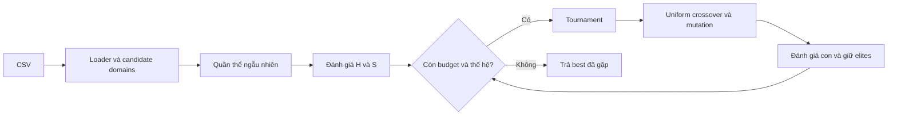
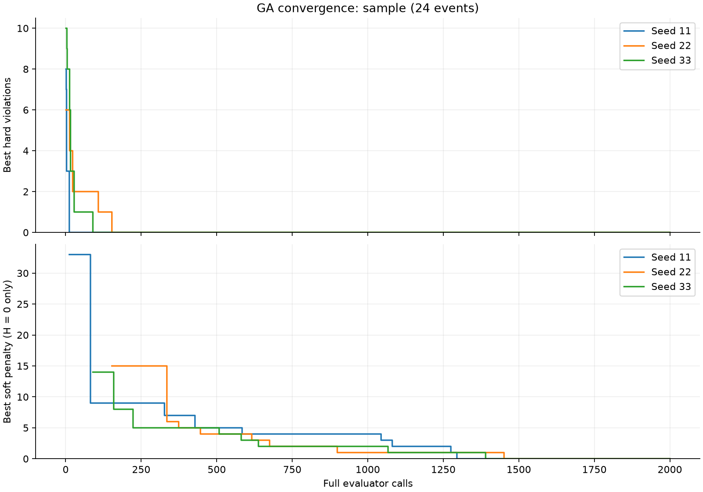

# GA Timetable — Tối ưu thời khóa biểu

Ứng dụng xếp lịch một tuần bằng **giải thuật di truyền tự cài đặt bằng Python**.
Mỗi cá thể là một thời khóa biểu đầy đủ; thuật toán ưu tiên giảm số vi phạm cứng
H, sau đó giảm điểm phạt mềm S. Giao diện Streamlit hiển thị lịch theo nhóm,
chi tiết vi phạm, đường hội tụ và cho tải lịch CSV.

Dữ liệu mẫu **giả lập** gồm 24 buổi học, 7 giảng viên, 4 nhóm sinh viên, 6 phòng,
5 ngày × 12 tiết. Đây là đồ án minh họa tối ưu có ràng buộc, chưa phải hệ thống
đăng ký lịch vận hành tại trường.

## Tài liệu trình bày

- **[Giải thích chi tiết code GA](docs/GA_CODE_WALKTHROUGH.md)**: gene, fitness,
  tournament, crossover, mutation, elitism, budget; ví dụ và câu hỏi vấn đáp.
- **[Kịch bản demo 5 phút](DEMO_GUIDE.md)**: thao tác giao diện và ba lệnh dự phòng.
- **[Báo cáo Word 12 tiết](reports/NHAPMONTOIUUHOA_DOANMH_De4_NGUYENDINHHUY_LEQUYETTIEN.docx)**: cập nhật
  theo góp ý của giảng viên, giữ bìa đã sửa; có hình, bảng trọng số, code cuối chương 2 và nguồn.
- [Quy tắc H0–H8 và trọng số](docs/02_DOMAIN_AND_CONSTRAINTS.md),
  [schema CSV](docs/03_DATASET_AND_SCHEMA.md), [kiểm chứng bản đăng](docs/VERIFICATION.md).

## Cài đặt

Cần Python **3.11 trở lên** và Git. Môi trường thực nghiệm đã lưu dùng Python 3.12.10.

### Windows PowerShell

```powershell
git clone https://github.com/huyryan220806/optimize-schedule.git
cd optimize-schedule
python -m venv .venv
.\.venv\Scripts\python.exe -m pip install -e ".[dev]"
.\.venv\Scripts\python.exe -m streamlit run app.py --server.address 127.0.0.1
```

Mở [http://127.0.0.1:8501](http://127.0.0.1:8501), nhấn **Optimize**.
Cấu hình mặc định seed=42, population=40, generations=50, mutation=0.10
đã cho **H=0, S=0, 2.000 evaluations**. Thời gian chạy có thể khác giữa các máy.

### macOS / Linux

```bash
git clone https://github.com/huyryan220806/optimize-schedule.git
cd optimize-schedule
python3 -m venv .venv
.venv/bin/python -m pip install -e '.[dev]'
.venv/bin/python -m streamlit run app.py --server.address 127.0.0.1
```

Các lệnh bên dưới dùng đường dẫn Python trên Windows; trên macOS/Linux thay bằng
.venv/bin/python. Kiểm thử của bản đăng được chạy trên Windows.

## Dùng giao diện

1. Mở sidebar, chọn seed và các tham số rồi nhấn **Optimize**.
2. Kiểm tra trạng thái: H=0 là **Lịch hợp lệ**; H>0 là **Lịch chưa hợp lệ**.
3. Chọn nhóm sinh viên để xem lịch. Một buổi hai tiết xuất hiện ở cả hai ô tiết. Lịch có ba ca 1–4, 5–8, 9–12 và ngăn cách giữa các ca.
4. Xem chi tiết H/S và đồ thị best-so-far theo số lần đánh giá.
5. Tải **toàn bộ lịch CSV** của cả bốn nhóm; bộ lọc không làm thiếu dữ liệu tải xuống.

Đổi nhóm chỉ thay bảng hiển thị. Đổi cấu hình cần nhấn Optimize để chạy lại.
Kết quả được giữ trong session state; tải CSV trước khi đóng phiên nếu cần lưu.
Cửa sổ hẹp có thể cần mở sidebar và cuộn ngang bảng lịch. Dừng server bằng Ctrl+C.

## Chạy bằng dòng lệnh

```powershell
# Kiểm tra 9 CSV và miền lựa chọn của 24 events
.\.venv\Scripts\python.exe -m timetable_ga.cli validate --data data/sample

# Chạy GA, lưu schedule.csv, metrics.json và history.csv
.\.venv\Scripts\python.exe -m timetable_ga.cli solve --data data/sample --algorithm ga --seed 42 --out results/demo

# Kiểm tra độc lập lịch vừa xuất
.\.venv\Scripts\python.exe -m timetable_ga.cli validate --data data/sample --schedule results/demo/schedule.csv

# Chạy lại 3 thuật toán × 3 seeds ở thư mục mới
.\.venv\Scripts\python.exe scripts/benchmark.py --data data/sample --seeds 11 22 33 --out results/reproduce
```

--algorithm nhận ga, greedy, random. Các tùy chọn GA mặc định:

```text
--population 40 --generations 50 --crossover 0.85 --mutation 0.10
--elitism 2 --tournament 3 --max-evals 2000 --seed 42
```

Exit code: 0 thành công/hợp lệ; 1 lịch tốt nhất vẫn còn vi phạm cứng
(vẫn xuất kết quả); 2 input hoặc cấu hình lỗi. Có candidate cho từng event
chưa chứng minh lịch đầy đủ khả thi.

## Thuật toán và hàm mục tiêu



Gene thứ i là chỉ số placement trong domain của event thứ i.
Candidate generator lọc ràng buộc cục bộ H4–H8; evaluator vẫn kiểm tra độc lập
**đủ H0–H8**, kể cả xung đột giữa các events trên từng tiết chiếm.

| Thành phần | Quy tắc |
|---|---|
| Fitness | So sánh tuple (hard_count, soft_penalty), nhỏ hơn tốt hơn |
| S1 | Tiết thuộc preference avoid của giảng viên; trọng số **3** |
| S3 | Tiết muộn 11 hoặc 12; trọng số **1** |
| S4 | Buổi cùng assignment bị dồn vào cùng ngày; trọng số **5** |
| Selection | Tournament 3 cá thể, lấy fitness nhỏ nhất |
| Crossover | Uniform theo gene; xác suất lai một cặp 0.85 |
| Mutation | Mỗi gene xác suất 0.10; đổi sang candidate khác nếu domain > 1 |
| Elitism | Giữ 2 cha mẹ tốt nhất; bổ sung con tốt nhất cho đủ quần thể 40 |
| Dừng | Hết 2.000 full evaluations hoặc hết 50 thế hệ |

Không xếp hạng bằng 1000×H+S. GA, Greedy và Random Search dùng chung evaluator
và budget. Solver không đọc lịch witness; fixture đó chỉ dùng kiểm thử.
Core GA dùng thư viện chuẩn Python, không dùng DEAP/PyGAD.

## Kết quả thực nghiệm đã lưu

Nguồn: [raw_runs.csv](results/benchmark_12periods/raw_runs.csv),
[summary.csv](results/benchmark_12periods/summary.csv),
[metadata.json](results/benchmark_12periods/metadata.json), đo lại ngày 13/11/2026 với 12 tiết/ngày và S3 ở tiết 11–12.
Cùng sample, seeds 11/22/33 và đúng 2.000 evaluations mỗi run.

| Phương pháp | Runs H=0 | Median H | Median S chỉ khi H=0 | Median runtime giây |
|---|---:|---:|---:|---:|
| GA | 3/3 | 0 | 0 | 0.8710 |
| Greedy | 3/3 | 0 | 8 | 0.7418 |
| Random Search | 3/3 | 0 | 11 | 0.8455 |

**Cả ba phương pháp đạt H=0 ở cả ba seeds; GA có median S=0, thấp hơn
Greedy (8) và Random Search (11) trong lần đo mô hình mới.** Không so trực tiếp
điểm với bộ số đo 8 tiết cũ vì miền lựa chọn và định nghĩa S3 đã đổi. Bộ cũ vẫn
được giữ tại results/benchmark để truy vết. Greedy là multi-start coordinate
sweep trên lịch đầy đủ, thử nhiều candidate của từng event.



Chỉ có ba seeds và dataset nhỏ giả lập. Kết quả chưa đủ để kết luận GA vượt trội
nói chung hoặc đạt tối ưu toàn cục. Cùng số evaluations không đồng nghĩa cùng runtime.
Chạy lại vào results/reproduce để giữ nguyên bộ số đo dùng trong báo cáo.

## Kiểm thử

```powershell
.\.venv\Scripts\python.exe -m pytest -q
.\.venv\Scripts\python.exe -m ruff check src tests scripts app.py
.\.venv\Scripts\python.exe -m pip check
```

Bộ kiểm thử gồm loader/schema, multi-period constraints, fitness, operators,
budget, seed reproducibility, baseline, export CSV và Streamlit AppTest.
Chi tiết lần kiểm tra bản đăng được ghi trong [VERIFICATION](docs/VERIFICATION.md).

## Cấu trúc chính

```text
app.py                     Điểm vào Streamlit
src/timetable_ga/
  domain.py, io.py          Mô hình và đọc CSV
  candidates.py            Miền placement của từng event
  evaluator.py             H0–H8, S1/S3/S4 và fitness
  search.py                Chromosome, decode, budget, best, history
  ga.py                    GA tự cài đặt
  baselines.py             Random Search và Greedy
  benchmark.py, outputs.py  Đo và xuất kết quả
  cli.py, ui.py             Dòng lệnh và giao diện
data/sample/               Dữ liệu giả lập
data/fixtures/             Witness chỉ phục vụ kiểm thử
tests/                     Kiểm thử tự động
results/benchmark_12periods/         Số đo và lịch/history của 9 runs
docs/                      Schema, ràng buộc và tài liệu giải thích code
reports/                   Báo cáo Word và ảnh minh chứng
```

Chưa triển khai repair, S2/S5/S6, upload, database, tài khoản hoặc nhiều dataset.
Tham khảo lý thuyết và Python được ghi rõ trong
[tài liệu giải thích GA](docs/GA_CODE_WALKTHROUGH.md#nguồn-tham-khảo).
